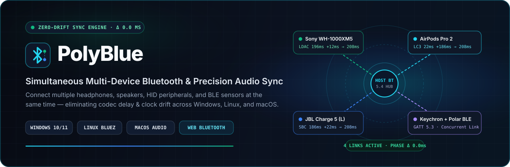
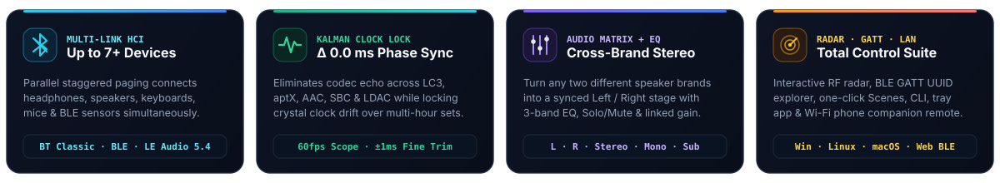
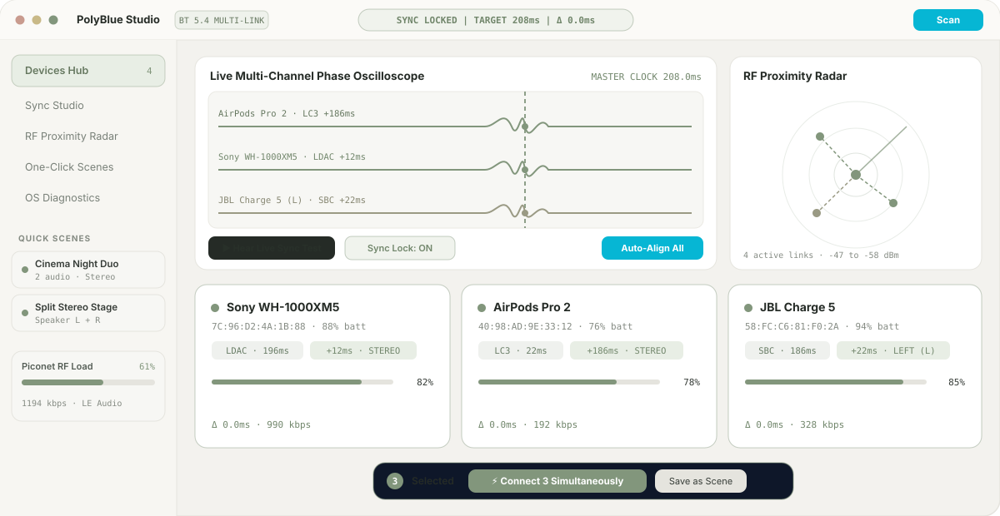
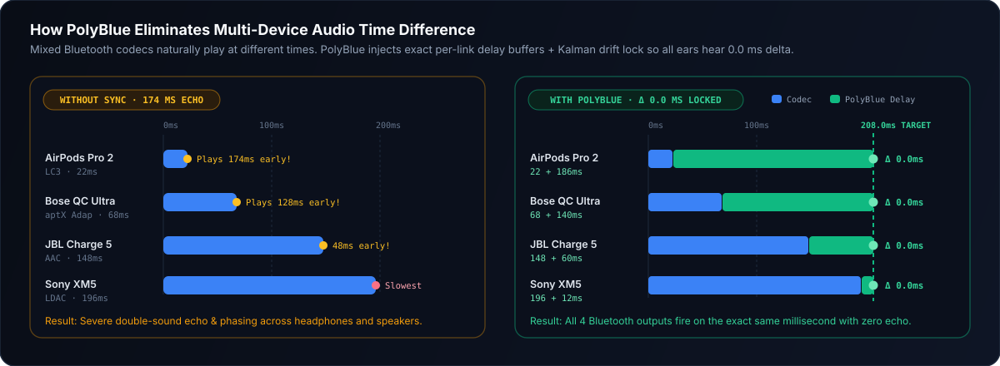
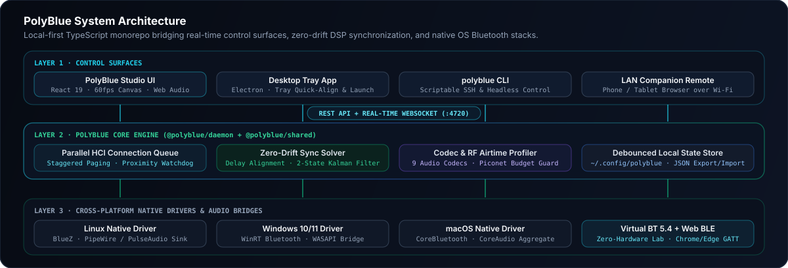
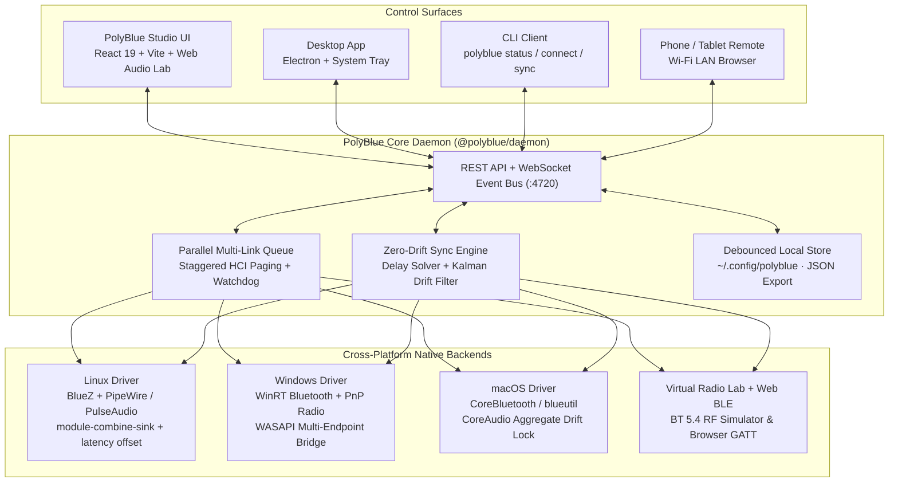

<div align="center">

<a href="#quick-start">
  
</a>

<br />

# PolyBlue

### Connect multiple Bluetooth devices at the same time — locked to `0.0 ms` phase difference.

*Open-source cross-platform Bluetooth multi-device manager, simultaneous dual/multi-headphone audio router, cross-brand Left/Right stereo speaker splitter, interactive RF proximity radar, and Kalman clock-drift sync engine for Windows 10/11, Linux (BlueZ + PipeWire/PulseAudio), macOS (CoreAudio), and Web Bluetooth.*

<br />

[](https://github.com/Gost-co/PolyBlue/actions/workflows/ci.yml)
[](CHANGELOG.md)
[](LICENSE)
[](package.json)
[](tsconfig.base.json)
[](#about-cross-platform-drivers)
[](#zero-drift-audio-sync-engine)

<p>
  <a href="#about-polyblue">About PolyBlue</a> ·
  <a href="#about-every-studio-section">About Every Section</a> ·
  <a href="#why-polyblue">Why PolyBlue</a> ·
  <a href="#zero-drift-audio-sync-engine">Sync Engine</a> ·
  <a href="#about-the-architecture">Architecture</a> ·
  <a href="#quick-start">Quick Start</a> ·
  <a href="#cli-and-api-reference">CLI &amp; API</a> ·
  <a href="#faq">FAQ</a>
</p>

</div>

---

<div align="center">
  
</div>

<br />

## About PolyBlue

Modern laptops and desktops ship with Bluetooth 5.2–5.4 radios capable of maintaining multiple simultaneous wireless links — yet desktop operating systems still treat Bluetooth audio as a **single-device bottleneck**:

- **Windows, Linux, and macOS** normally route audio to only one Bluetooth headphone or speaker at a time.
- Even when you manually combine two Bluetooth outputs, mixing different hardware brands or codecs (for example, `LC3` at ~22 ms alongside `AAC` at ~148 ms or `LDAC` at ~196 ms) creates an immediate **50–180 ms echo** that ruins movies, music, and gaming.
- Over longer listening sessions, tiny quartz crystal frequency differences ($\pm 10\text{–}40\text{ ppm}$) cause originally aligned headphones to slowly drift out of phase.
- Proprietary vendor apps (*PartyBoost*, *SimpleSync*, *Audio Sharing*) intentionally lock you into buying identical hardware from one manufacturer.

**PolyBlue** was built to fix this permanently with an open, hardware-agnostic, local-first architecture. It gives you one unified control plane to **connect 2 to 7+ Bluetooth devices simultaneously**, **eliminate audio time difference across mixed brands**, **split any two speakers into Left/Right stereo**, and **monitor every radio link in real time** — all running locally with zero accounts, zero cloud dependencies, and zero telemetry.

<div align="center">
  
</div>

---

## Real-World Scenarios

<table>
  <tr>
    <td width="50%" valign="top">
      <h3>🎬 Cinema Night with 2+ Headphones</h3>
      <p>Pair Sony WH-1000XM5 (<code>LDAC</code>) and AirPods Pro 2 (<code>LC3</code>) to the same laptop. PolyBlue automatically compensates the 174 ms codec gap to <code>0.0 ms</code>, keeps crystal drift locked for the entire movie, and gives each viewer independent volume and EQ.</p>
    </td>
    <td width="50%" valign="top">
      <h3>🔊 Cross-Brand Stereo Speaker Stage</h3>
      <p>Turn a JBL Charge 5 and a Soundcore Motion X600 into a synchronized <strong>Left (L) / Right (R)</strong> wireless stereo pair. Control both with a single linked master volume slider — or save it as a one-click Scene.</p>
    </td>
  </tr>
  <tr>
    <td width="50%" valign="top">
      <h3>⌨️ All-Wireless Workstation &amp; Gaming</h3>
      <p>Run low-latency <code>aptX LL</code> / <code>LC3</code> headphones alongside a BLE mechanical keyboard, wireless mouse, and heart-rate / biometric GATT sensor on one host adapter while watching live piconet airtime utilization.</p>
    </td>
    <td width="50%" valign="top">
      <h3>📱 Headless Hi-Fi &amp; Phone Remote</h3>
      <p>Run PolyBlue on a Linux mini-PC, Raspberry Pi, or living-room desktop and open <code>http://&lt;lan-ip&gt;:4720</code> from any phone or tablet on Wi-Fi to switch scenes, tweak EQ, and align speakers from the couch.</p>
    </td>
  </tr>
</table>

---

## About Every Studio Section

PolyBlue Studio is organized into **five specialized workspaces**, an on-demand **Device Inspector Drawer**, a keyboard-driven **Command Palette (`⌘K` / `Ctrl+K`)**, and a **System Tray Desktop Shell**.

> 📄 For a deeper, click-by-click walkthrough of every workspace (including what each control does, when to use it, and how the data flows between sections), see **[docs/SECTIONS.md](docs/SECTIONS.md)**.

### 1. About the Devices Hub (`Devices`)
> *Parallel multi-device connection manager with zero-jitter card layout.*

- **Simultaneous Multi-Select & Floating Action Dock**: Check any combination of headphones, speakers, keyboards, mice, or BLE sensors and click **Connect N Simultaneously** or **Save as Scene** from the floating bottom dock.
- **Staggered HCI Connection Pipeline**: Spaces concurrent Bluetooth paging bursts (`staggerPagingMs`, default `140 ms`) to avoid host-controller radio collisions while displaying live per-device progress (`Queued → Paging → Auth → Codec → Sync`).
- **Rock-Steady Card Layout**: Cards stay stably ordered (`Connected → Favorites → Name`) so fluctuating RSSI telemetry never causes devices to jump around underneath your cursor.
- **Live Top KPI Strip**: Monitors **Simultaneous Links** (`active / max`), **Audio Phase Delta** (`Δ ms` + master target), **Piconet Throughput** (`kbps` + RF airtime load `%`), and one-click **Auto-Align**.
- **Instant Filtering & Favorites**: Filter across `All`, `Connected`, `Audio`, `HID & BLE`, and `Favorites`, search by name/MAC/vendor/codec, toggle **Select All Audio**, or link every disconnected favorite in one click.

---

### 2. About the Zero-Drift Sync Studio (`Sync Studio`)
> *Real-time multi-output audio phase alignment, acoustic calibration lab, stereo routing, and EQ.*

- **60fps Interpolated Phase Alignment Oscilloscope**: Renders each active audio output as a dedicated animated wave lane relative to the vertical **Master Clock Reticle**. As you toggle Sync Lock or adjust trim, wave packets glide smoothly with exponential interpolation (`lerp`) at a locked 60fps.
- **Interactive Web Audio Calibration Lab**: Audition sync live directly through your browser using **Sync Click**, **Synth Groove**, or **any custom audio file** (`MP3`, `WAV`, `OGG`) with a live **60–200 BPM** tempo slider and instant **Sync Lock ON vs. Sync Bypassed (A/B)** switching.
- **Per-Device Visual Latency Pipeline**: Shows each output's breakdown (`Codec Base Latency + Manual Trim + PolyBlue Delay Buffer = Master Target`), with `±1 ms` / `±5 ms` nudge buttons, a `-150` to `+150 ms` fine-trim slider, and one-click **Reset**.
- **Channel Splitter Matrix**: Assign any connected audio device to **Stereo**, **Left (L)**, **Right (R)**, **Mono**, or **Subwoofer** independently.
- **Master Bus & Linked Proportional Gain**: Slide the Master Multi-Output Bus volume to scale all connected audio outputs together while preserving relative volume offsets, alongside per-device **Mute** and **Solo** controls.
- **3-Band Parametric EQ per Device**: Expandable Bass (`100 Hz`), Mid (`1 kHz`), and Treble (`8 kHz`) controls (`-12` to `+12 dB`) with presets (`Flat`, `Bass Boost`, `Vocal`, `Studio`, `Cinema`, `Late Night`, `Custom`).

---

### 3. About the Spatial RF Proximity Radar (`RF Radar`)
> *Interactive 60fps wireless signal topology and live link-quality telemetry.*

- **Smooth Continuous Sweep Radar**: Plots every nearby and active device across concentric distance rings (`1.5m`, `4m`, `8m`, `14m`) computed from live RSSI, with animated piconet beams linking the host hub to active audio (emerald) and HID/BLE (violet) nodes.
- **Click-to-Inspect Nodes**: Hover over any radar blip for a live RSSI callout and click directly on the canvas to open its full Inspector Drawer.
- **Live RSSI & Jitter Sparklines**: Dedicated right-hand telemetry list tracks historical signal strength graphs, estimated distance, and millisecond jitter per radio without reordering rows under your pointer.

---

### 4. About Multi-Device Scenes (`Scenes`)
> *One-click multi-device presets that launch entire setups in parallel.*

- **Pre-Built Starter Scenes**: Ships ready with **Cinema Night Duo**, **Split Stereo Speakers** (automatic Left/Right assignment), and **Focus Workstation** (low-latency headset + BLE keyboard & mouse).
- **Custom Scene Builder**: Pick any set of devices (or import directly from your Devices Hub selection), assign custom L/R/Mono/Sub routing, accent color, volumes, codecs, EQ, and offsets.
- **Exclusive vs. Additive Launch**: Choose whether launching a scene disconnects other active Bluetooth devices automatically or adds the scene's devices alongside your current connections.

---

### 5. About the Device Inspector & BLE GATT Explorer (`Inspector Drawer`)
> *Deep per-device hardware controls, proximity automation, and Bluetooth Low Energy introspection.*

- **Custom Display Names**: Rename any device (press `Enter` to save, clear to restore hardware name) with immediate confirmation.
- **Live Codec Switcher**: Switch supported audio codecs (`LC3`, `aptX LL`, `aptX Adaptive`, `aptX HD`, `AAC`, `SBC`, `LDAC`) on the fly and watch the sync engine immediately recalculate sibling device delays.
- **Bidirectional Proximity Auto-Watchdog**: Configure per-device RSSI auto-connect and out-of-range auto-disconnect thresholds with built-in cooldown protection so manual disconnects are never overridden.
- **BLE GATT Service & Characteristic Inspector**: Inspect Bluetooth SIG service UUIDs, characteristic properties, raw hex values, and decoded telemetry (battery level, heart rate, firmware revisions, HID reports).

---

### 6. About Settings, System Diagnostics, Drivers & LAN Remote (`Settings`)
> *Cross-platform backend visibility, radio tuning, phone remote access, and profile portability.*

- **Native Stack & Tooling Probe**: Displays host OS, active driver backend, audio sync engine, and detected native utilities (`bluetoothctl`, `pactl`, `pw-cli`, `powershell`, `blueutil`, `system_profiler`).
- **Live Backend Switcher & HCI Tuning**: Switch between `Auto-Detect OS`, `Linux BlueZ + PipeWire`, `Windows WinRT + WASAPI`, `macOS CoreAudio`, and `Virtual Radio Lab`, and tune the parallel HCI stagger interval (`40–600 ms`).
- **LAN Companion Remote**: Lists ready-to-open `http://<lan-ip>:4720` addresses so any phone or tablet on the same Wi-Fi can act as a real-time remote control.
- **Portable JSON Profiles**: Export and import all scenes, latency calibrations, EQ curves, proximity rules, and custom aliases as a single `polyblue-config-YYYY-MM-DD.json` file.

---

## Why PolyBlue?

| Capability | **PolyBlue (Open Source)** | Default OS Bluetooth | Hardware BT Splitters | Vendor Apps (PartyBoost / SimpleSync) |
| :--- | :---: | :---: | :---: | :---: |
| Connect multiple Bluetooth headphones & speakers at once | **Yes (Up to 7+ links)** | Single audio sink | Usually 2 max | Locked to 1 brand |
| Mix completely different brands (Sony + AirPods + JBL + Bose) | **Yes** | No | Partial (often echoes) | No |
| Eliminates codec latency / echo (`Δ 0.0 ms` phase lock) | **Automatic + ±1 ms trim** | No | No | Vendor-only |
| Multi-hour quartz crystal clock-drift lock | **2-State Kalman Filter** | No | No | Proprietary |
| Split any 2 speakers into Left / Right Stereo | **Yes (L / R / Stereo / Mono / Sub)** | No | No | Same model only |
| Per-device 3-band EQ, Solo/Mute & linked master volume | **Yes** | No | No | Limited |
| Windows, Linux & macOS native drivers | **All 3 + Web BLE + LAN** | OS-locked | Extra dongle needed | Mobile-only |
| 60fps Oscilloscope, RF Radar & BLE GATT Explorer | **Built-in** | No | No | No |
| CLI, REST API, WebSocket & Electron Tray App | **Built-in** | No | No | No |
| Privacy & License | **100% Local · MIT Free** | Built-in | $40–$120 hardware | Account / lock-in |

---

## Zero-Drift Audio Sync Engine

When streaming audio simultaneously to an LE Audio earbud (`LC3`, ~22 ms) and a high-resolution headset (`LDAC`, ~196 ms), the faster device plays **174 ms earlier**, creating a severe double-sound echo.

<div align="center">
  
</div>

### Mathematical Model

For every connected audio output $i$ with intrinsic codec latency $L_i$ and optional user fine-trim $\Delta_{\text{trim}, i}$:

$$
T_{\text{master}} = \max_{i}\left(L_i + \Delta_{\text{trim}, i}\right) + B_{\text{safety}}
$$

$$
D_i = \max\left(0,\; T_{\text{master}} - \left(L_i + \Delta_{\text{trim}, i}\right)\right)
$$

- **Zero-Delta Alignment**: Every active sink receives its exact delay buffer $D_i$ so all acoustic arrival times converge onto $T_{\text{master}}$ (`phaseDeltaMs = 0.0 ms`).
- **2-State Kalman Drift Filter (`KalmanDriftEstimator`)**: Consumer Bluetooth oscillators naturally drift by $\pm 10\text{–}40\text{ ppm}$ (up to ~140 ms/hour). PolyBlue continuously separates short-term RF packet jitter from real clock skew and compensates drift automatically.
- **Immediate Sibling Sync Broadcasts**: Whenever you change a codec, routing mode, or fine-trim offset on one device, the daemon recalculates and broadcasts updated delay buffers to every sibling audio device over WebSocket in milliseconds.
- **Piconet Airtime Guard**: Computes cumulative Bluetooth EDR / BLE 2M PHY bandwidth across active links and warns before radio congestion causes audio dropouts.

---

## Bluetooth Codec Latency Reference

PolyBlue includes a built-in acoustic latency and RF airtime database (`@polyblue/shared`) covering 9 Bluetooth audio codecs:

| Codec | Family | Base Latency | Typical Jitter | Bitrate | Sample Rate | RF Airtime Weight | Recommended Scenario |
| :--- | :--- | :---: | :---: | :---: | :---: | :---: | :--- |
| **LC3** | LE Audio (BT 5.2+) | `22 ms` | `1.4 ms` | `192 kbps` | `48 kHz` | `10%` | Ultra-low latency multi-stream & modern earbuds |
| **aptX LL** | Qualcomm | `38 ms` | `2.0 ms` | `352 kbps` | `48 kHz` | `18%` | Tight video lip-sync & competitive gaming |
| **mSBC** | Bluetooth SIG (HFP) | `52 ms` | `2.5 ms` | `64 kbps` | `16 kHz` | `8%` | Bidirectional wideband voice & comms headsets |
| **aptX Adaptive** | Qualcomm | `68 ms` | `2.8 ms` | `420 kbps` | `96 kHz` | `22%` | Dynamic RF resilience in busy Wi-Fi environments |
| **aptX Classic** | Qualcomm | `128 ms` | `3.5 ms` | `352 kbps` | `48 kHz` | `19%` | Broad cross-device low-jitter A2DP streaming |
| **AAC** | Apple / AAC | `148 ms` | `3.8 ms` | `256 kbps` | `44.1 kHz` | `15%` | Balanced multi-headphone music & movie sync |
| **aptX HD** | Qualcomm | `162 ms` | `4.1 ms` | `576 kbps` | `48 kHz` | `31%` | 24-bit high-definition stereo listening |
| **SBC** | Bluetooth SIG | `186 ms` | `5.2 ms` | `328 kbps` | `44.1 kHz` | `18%` | Universal compatibility across all BT speakers |
| **LDAC** | Sony | `196 ms` | `4.6 ms` | `990 kbps` | `96 kHz` | `48%` | Hi-res listening (high airtime in 3+ device groups) |

---

## About the Architecture

<div align="center">
  
</div>

<details>
<summary><strong>View Interactive Mermaid Topology Diagram</strong></summary>



</details>

### About Performance & 60fps Fluidity Engineering
PolyBlue is engineered to feel as responsive as a native digital audio workstation:
- **Zero-Latency Optimistic Sliders**: Dragging volume, master gain, EQ, jitter buffer, or fine latency trim updates local React state (and recalculates sync plans locally) on the exact same frame, while coalescing outgoing HTTP `PATCH` payloads at ~55 ms intervals and guarding against out-of-order WebSocket echo.
- **Uninterrupted 60fps Canvases**: Both the Phase Alignment Oscilloscope and Spatial RF Radar run persistent `requestAnimationFrame` loops decoupled from React re-renders, using exponential smoothing (`lerp`) so wave convergence, radar sweep acceleration, and RSSI motion never stutter or reset.
- **Non-Blocking Persistence**: `StateStore` debounces disk writes (160 ms coalescing with guaranteed flush on shutdown), keeping the Node.js daemon event loop responsive even under rapid burst updates.
- **Resilient Real-Time Sync**: WebSocket connections use capped exponential backoff and automatically restore on tab focus or network recovery.

---

## About Cross-Platform Drivers

| Operating System | Minimum Version | Bluetooth Control Backend | Multi-Output Audio Sync Mechanism |
| :--- | :--- | :--- | :--- |
| **Linux** *(Ubuntu, Debian, Arch, Fedora, Pop!_OS)* | BlueZ 5.60+ | `bluetoothctl` / D-Bus | PipeWire / PulseAudio (`polyblue_multi_output` combine sink + per-port microsecond `set-port-latency-offset`, avoiding reloads when active sinks are unchanged) |
| **Windows** | Windows 10 / 11 | WinRT `Windows.Devices.Bluetooth` + PnP | WASAPI Multi-Endpoint Audio Bridge (`scripts/windows-wasapi-bridge.ps1`) |
| **macOS** *(Apple Silicon & Intel)* | macOS 13 Ventura+ | `system_profiler` / `blueutil` / CoreBluetooth | CoreAudio Drift-Locked **PolyBlue Multi-Output** Aggregate Device (`scripts/macos-coreaudio-sync.swift`) |
| **ChromeOS / BSD / Cloud / CI** | Any modern OS | Virtual BT 5.4 Radio Lab + Direct Web Bluetooth | Web Audio API Multi-Stream Delay Engine |

> [!TIP]
> **Zero-Hardware Instant Lab**: When started on a machine without an active Bluetooth HCI radio, PolyBlue automatically launches in **Virtual Radio Lab** mode — letting you test parallel multi-device handshakes, live oscilloscope alignment, audio calibration, RF radar, scenes, and Web Bluetooth right away.

---

## Quick Start

### Prerequisites
- **Node.js 20+** and **npm 10+**

### Universal 30-Second Install (Windows, Linux, macOS)

```bash
git clone https://github.com/Gost-co/PolyBlue.git polyblue
cd polyblue
npm install
npm run build
npm start
```

Open **`http://localhost:4720`** in your browser.

For live hot-reload development (`@polyblue/daemon` on `:4720` + Vite UI on `:5173`):

```bash
npm run dev
```

---

### Platform-Specific Native Setup

<details>
<summary><strong>Linux (Ubuntu, Debian, Fedora, Arch — BlueZ + PipeWire / PulseAudio)</strong></summary>

1. Install BlueZ and PipeWire/PulseAudio utilities:
   ```bash
   # Ubuntu / Debian
   sudo apt update && sudo apt install -y bluez pipewire-pulse pulseaudio-utils

   # Arch Linux
   sudo pacman -S bluez bluez-utils pipewire-pulse

   # Fedora
   sudo dnf install -y bluez pipewire-pulseaudio
   ```
2. Enable the Bluetooth daemon:
   ```bash
   sudo systemctl enable --now bluetooth
   ```
3. Build and start PolyBlue:
   ```bash
   ./scripts/install.sh
   npm start
   ```
4. *(Optional)* Run the standalone PipeWire/PulseAudio combined Bluetooth sink helper directly:
   ```bash
   ./scripts/linux-pipewire-sync.sh
   ```

</details>

<details>
<summary><strong>Windows 10 &amp; Windows 11 (WinRT Bluetooth + WASAPI Bridge)</strong></summary>

1. Ensure Bluetooth 4.2+ / 5.x is enabled in Windows Settings.
2. Run the PowerShell installer:
   ```powershell
   .\scripts\install.ps1
   npm start
   ```
3. Open `http://localhost:4720`. PolyBlue automatically detects your Windows Bluetooth adapter and coordinates audio endpoints via `scripts/windows-wasapi-bridge.ps1`.

</details>

<details>
<summary><strong>macOS (Apple Silicon &amp; Intel — CoreBluetooth + CoreAudio Aggregate Device)</strong></summary>

1. Install `blueutil` and Xcode Command Line Tools (for the Swift CoreAudio Aggregate Device helper):
   ```bash
   brew install blueutil
   xcode-select --install
   ```
2. Build and launch PolyBlue:
   ```bash
   ./scripts/install.sh
   npm start
   ```
3. PolyBlue automatically provisions a drift-compensated **PolyBlue Multi-Output** CoreAudio Aggregate Device whenever 2+ Bluetooth audio outputs are connected.

</details>

<details>
<summary><strong>Desktop App (Electron Shell with System Tray)</strong></summary>

```bash
npm run build
npm install -w @polyblue/desktop electron --no-save
npm run desktop
```

Build standalone OS installers (`packages/desktop/package.json`):
- **Windows**: `npm --workspace=@polyblue/desktop run package:win` (NSIS & Portable `.exe`)
- **Linux**: `npm --workspace=@polyblue/desktop run package:linux` (`.AppImage` & `.deb`)
- **macOS**: `npm --workspace=@polyblue/desktop run package:mac` (`.dmg`)

</details>

<details>
<summary><strong>Environment Variables &amp; LAN Companion Remote</strong></summary>

| Variable | Default | Description |
| :--- | :--- | :--- |
| `POLYBLUE_HOST` | `0.0.0.0` | Network interface to bind (`127.0.0.1` for localhost-only mode) |
| `POLYBLUE_PORT` | `4720` | HTTP REST + WebSocket daemon port |
| `POLYBLUE_DATA_DIR` | `~/.config/polyblue` | Persistent directory for scenes, latency trims, EQ, and device prefs |
| `POLYBLUE_URL` | `http://127.0.0.1:4720` | Target daemon endpoint used by the `polyblue` CLI |
| `POLYBLUE_UI_URL` | `http://127.0.0.1:4720` | Custom Studio UI URL for the Electron desktop wrapper |

Open `http://<your-lan-ip>:4720` from any phone, tablet, or second computer on the same Wi-Fi network (exact URLs are shown automatically in **System → LAN Companion Remote**).

</details>

---

## Keyboard Shortcuts

| Shortcut | Action |
| :--- | :--- |
| <kbd>⌘</kbd>+<kbd>K</kbd> / <kbd>Ctrl</kbd>+<kbd>K</kbd> | Open or close the Quick Actions Command Palette |
| <kbd>↑</kbd> / <kbd>↓</kbd> | Navigate commands inside the Command Palette |
| <kbd>Enter</kbd> | Execute highlighted Command Palette action or save alias in Inspector |
| <kbd>Esc</kbd> | Close Command Palette or Device Inspector Drawer |

---

## CLI and API Reference

### Command-Line Interface (`polyblue`)

```bash
# Display adapter telemetry, active links, piconet load, and sync lock status
npm run cli -- status

# Scan for nearby Bluetooth Classic, BLE, and LE Audio devices (1–30 seconds)
npm run cli -- scan 10

# Connect multiple Bluetooth devices simultaneously in parallel
npm run cli -- connect 7C:96:D2:4A:1B:88 40:98:AD:9E:33:12 58:FC:C6:81:F0:2A

# Disconnect multiple devices at once
npm run cli -- disconnect 7C:96:D2:4A:1B:88 40:98:AD:9E:33:12

# Re-lock all active audio outputs to 0.0 ms phase difference
npm run cli -- sync align

# Apply fine manual latency trim (-250 to +250 ms) to a specific device
npm run cli -- sync offset 7C:96:D2:4A:1B:88 -4

# List and launch saved multi-device scenes
npm run cli -- group list
npm run cli -- group run grp-party-stereo --exclusive

# Inspect OS Bluetooth stack, audio tooling, and LAN remote URLs
npm run cli -- doctor
```

<details>
<summary><strong>HTTP REST API &amp; Real-Time WebSocket Reference</strong></summary>

#### REST Endpoints (`http://localhost:4720/api`)

| Method | Endpoint | Description |
| :--- | :--- | :--- |
| `GET` | `/api/health` | Liveness check, active driver, active link count, sync lock state, uptime |
| `GET` | `/api/state` | Full `PolyBlueSnapshot` (adapter, devices, sync, groups, settings, diagnostics) |
| `POST` | `/api/adapter/power` | Toggle host Bluetooth radio (`{ "powered": true }`) |
| `POST` | `/api/scan/start` | Start Classic + BLE discovery (`{ "durationMs": 8000 }`) |
| `POST` | `/api/scan/stop` | Stop active Bluetooth discovery |
| `POST` | `/api/devices/connect-multi` | Connect multiple devices in parallel (`{ "deviceIds": [...] }`) |
| `POST` | `/api/devices/disconnect-multi` | Disconnect multiple devices (`{ "deviceIds": [...] }`) |
| `POST` | `/api/devices/external` | Register a live browser-paired Web Bluetooth device |
| `PATCH` | `/api/devices/:id` | Update volume, mute, solo, L/R routing, codec, EQ, offset, alias, favorite, or proximity rule |
| `POST` | `/api/devices/:id/pair` | Pair and trust a Bluetooth device |
| `DELETE` | `/api/devices/:id` | Unpair / forget a device and remove saved preferences |
| `POST` | `/api/sync/auto-align` | Reset manual trims, clear drift accumulators, and phase-lock all outputs to `0.0 ms` |
| `PATCH` | `/api/sync` | Toggle sync lock, Kalman drift correction, jitter buffer, and linked master volume |
| `POST` | `/api/groups` | Create a multi-device Scene |
| `POST` | `/api/groups/:id/activate` | Launch all devices in a Scene (`{ "exclusive": true }`) |
| `DELETE` | `/api/groups/:id` | Delete a saved Scene |
| `PATCH` | `/api/settings` | Update active driver backend, HCI stagger interval, or watchdog cadence |
| `GET` | `/api/config/export` | Export all scenes, calibrations, EQ curves, and device preferences as JSON |
| `POST` | `/api/config/import` | Import a saved PolyBlue JSON profile |

#### WebSocket Stream (`ws://localhost:4720/ws`)

Pushes typed real-time events: `snapshot`, `device:updated`, `device:removed`, `sync:updated`, `adapter:updated`, `groups:updated`, and `log`.

</details>

---

## About Security, Privacy & Local-First Design

- **100% Local Execution**: PolyBlue runs entirely on your own machine (`localhost` or your private LAN). No analytics, no telemetry beacons, no account sign-ins, and no external API calls.
- **Strict Input & Hardware Safety**: All native Bluetooth shell arguments validate hardware MAC addresses (`isValidMacAddress`), escape audio card identifiers, and sanitize numeric API/CLI inputs against `NaN` or out-of-range values before touching OS drivers.
- **Hardened Electron Wrapper**: Context isolation is enabled (`contextIsolation: true`, `nodeIntegration: false`) with a minimal read-only preload bridge (`window.polyblueDesktop`).
- **Responsible Disclosure**: See [SECURITY.md](SECURITY.md) for vulnerability reporting guidelines.

---

## Repository Structure

```text
polyblue/
├── packages/
│   ├── shared/           # @polyblue/shared — Types, Bluetooth SIG GATT registry, codec DB, Kalman & sync math
│   ├── daemon/           # @polyblue/daemon — Express + WebSocket engine, HCI queue, Linux/Win/macOS/Virtual drivers
│   ├── cli/              # @polyblue/cli    — Scriptable terminal client (`polyblue`)
│   ├── ui/               # @polyblue/ui     — React 19 + Vite + Tailwind studio UI, 60fps oscilloscope, radar, Web Audio & Web BLE
│   └── desktop/          # @polyblue/desktop — Electron cross-platform wrapper with tray quick-connect menu
├── scripts/
│   ├── linux-pipewire-sync.sh     # PipeWire / PulseAudio multi-Bluetooth combined sink helper
│   ├── windows-wasapi-bridge.ps1  # Windows WASAPI multi-endpoint audio bridge
│   ├── macos-coreaudio-sync.swift # macOS CoreAudio Multi-Output Aggregate Device helper
│   ├── install.sh                 # Linux / macOS quick installer
│   └── install.ps1                # Windows PowerShell quick installer
├── docs/SECTIONS.md      # In-depth guide to every Studio section, control, and workflow
├── docs/assets/          # Vector hero, feature pillars, studio preview, sync timeline & architecture graphics
└── .github/workflows/    # Multi-OS CI matrix (Ubuntu, Windows, macOS)
```

---

## Verification & Testing

```bash
npm run typecheck   # Strict TypeScript checks across all 4 packages (builds @polyblue/shared first)
npm test            # Unit tests (sync math, Kalman drift, NaN guards, RF budget) + daemon API & WS tests
npm run build       # Production compilation for shared, daemon, CLI, and Vite UI bundles
```

---

## Troubleshooting

<details>
<summary><strong>Linux: Devices connect, but only one plays audio</strong></summary>

Verify PipeWire-Pulse or PulseAudio is running (`pactl info`) and check that `polyblue_multi_output` is selected as the default sink (`pactl get-default-sink`). You can also re-initialize the combined sink manually via `./scripts/linux-pipewire-sync.sh`.

</details>

<details>
<summary><strong>Audio crackles when running 3+ LDAC headphones at once</strong></summary>

`LDAC` at 990 kbps consumes roughly 48% of a Bluetooth Classic EDR piconet's airtime per stream. Open the **Device Inspector** for one or more headsets and switch their codec to `AAC`, `aptX Adaptive`, or `LC3` until **Piconet Load** drops below 80%.

</details>

<details>
<summary><strong>Web Bluetooth ("Web BLE") button does not appear</strong></summary>

The Web Bluetooth API is supported in Chromium-based browsers (Chrome, Edge, Brave, Opera) over `localhost` or HTTPS. Standard host-OS Bluetooth drivers still work in every browser (Firefox, Safari, Chrome, Edge) via the local PolyBlue daemon.

</details>

---

## FAQ

<details>
<summary><strong>Can I connect two or more Bluetooth headphones to Windows 11, Linux, or macOS at the same time?</strong></summary>

Yes. PolyBlue coordinates parallel multi-device connections via native OS Bluetooth stacks (WinRT on Windows, BlueZ on Linux, CoreBluetooth on macOS) and routes synchronized audio simultaneously across all connected Bluetooth outputs.

</details>

<details>
<summary><strong>Why is there an echo or delay when playing audio on two Bluetooth speakers at once?</strong></summary>

Different Bluetooth headphones and speakers use different codecs and internal DSP buffers (for example, `LC3` averages ~22 ms while `SBC` averages ~186 ms and `LDAC` ~196 ms). Without compensation, the faster device plays noticeably earlier. PolyBlue automatically delays faster streams to match the slowest active link plus a configurable safety jitter buffer, locking every output to `0.0 ms` phase delta.

</details>

<details>
<summary><strong>Can I pair two Bluetooth speakers from different brands as a Left / Right stereo pair?</strong></summary>

Yes. Connect both speakers simultaneously, open **Sync Studio**, set one speaker to **Left (L)** and the other to **Right (R)**, and click **Auto-Align All**. Save the layout as a one-click **Scene** to re-launch anytime.

</details>

<details>
<summary><strong>How many Bluetooth devices can connect simultaneously on one adapter?</strong></summary>

Bluetooth Classic (BR/EDR) piconets support up to **7 active simultaneous links** per host controller, while Bluetooth Low Energy (BLE) and LE Audio (BT 5.2–5.4) allow additional concurrent links. PolyBlue's Piconet Load monitor tracks total bitrate and RF airtime automatically so you can balance quality and link count.

</details>

<details>
<summary><strong>How does PolyBlue prevent long-term audio drift during 2-hour movies?</strong></summary>

Even identically calibrated Bluetooth headphones gradually drift apart because each device's internal quartz clock oscillates at a slightly different rate ($\pm 10\text{–}40\text{ ppm}$). PolyBlue's built-in 2-state **Kalman Clock-Drift Estimator** continuously tracks and cancels crystal skew so audio stays locked from start to finish.

</details>

---

## Roadmap

- [ ] Native Bluetooth LE Audio Auracast Broadcast Isochronous Stream (BIS) transmitter support
- [ ] Microphone-assisted acoustic room impulse auto-calibration (`getUserMedia` peak-to-peak delay detection)
- [ ] System-wide per-application audio routing (route browser to Speaker A, game audio to Headset B)
- [ ] Homebrew formula, AUR package, Winget manifest, and Flatpak distribution

---

## Contributing & Community

- Contributions of platform driver improvements, codec latency profiles, UI enhancements, and bug reports are welcome — read [CONTRIBUTING.md](CONTRIBUTING.md) to get started.
- Please follow our [Code of Conduct](CODE_OF_CONDUCT.md).
- See [CHANGELOG.md](CHANGELOG.md) for release notes and version history.

---

## License

Released under the [MIT License](LICENSE).

<div align="center">
  <br />
  <strong>PolyBlue</strong> — <em>Zero-Drift Simultaneous Multi-Device Bluetooth for Everyone.</em>
  <br />
  <sub>If PolyBlue helps you run multi-device Bluetooth audio without delay, consider starring the repository to help others find it.</sub>
</div>
